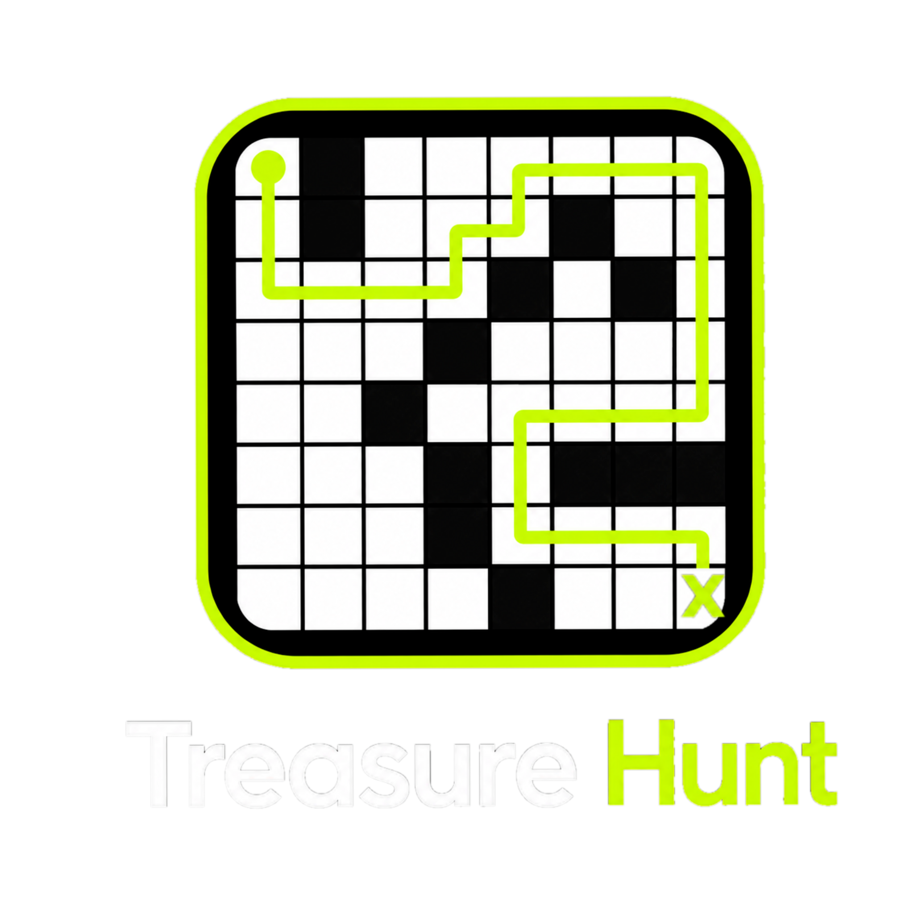

<!--
File: README.md
Document Title: Treasure Hunt Game
Author: Alysha Pursley
Date: August 2026
-->

<div align="center">

<h1>Treasure Hunt Game 🏴‍☠️</h1>

<p><a href="https://github.com/apursley2012/treasure-hunt-game/stargazers"></a> <a href="https://github.com/apursley2012/treasure-hunt-game/forks"></a> <a href="https://github.com/apursley2012/treasure-hunt-game/issues"></a> <a href="https://github.com/apursley2012/treasure-hunt-game/commits"></a> <a href="https://github.com/apursley2012/treasure-hunt-game"></a> <a href="https://github.com/apursley2012/treasure-hunt-game"></a></p>

<p><a href="https://apursley2012.github.io/treasure-hunt-game/"></a>      </p>

<p><strong>A playable treasure-hunt maze where a player races an intelligent JavaScript agent across randomized valid boards, with difficulty controls and the original reinforcement-learning source preserved for reference.</strong></p>



<p><a href="https://apursley2012.github.io/treasure-hunt-game/">Open the live project</a> · <a href="https://github.com/apursley2012/treasure-hunt-game">View the repository</a> · <a href="https://github.com/apursley2012/treasure-hunt-game/issues/new/choose">Report an issue or request an addition</a></p>

</div>

---

## Table of Contents 📖

*   [Project Overview 🔎](#project-overview)
    *   [Purpose 🎯](#purpose)
    *   [Design Style and Inspiration 🎨](#design-style-and-inspiration)
    *   [Main Color Palette 🌈](#main-color-palette)
    *   [Preview Screenshots 🖼️](#preview-screenshots)
*   [Key Features ✨](#key-features)
*   [Tech Stack 🛠️](#tech-stack)
*   [Live Demo 🚀](#live-demo)
*   [Installation 📦](#installation)
    *   [Local Use 💻](#local-use)
    *   [GitHub Pages Deployment 🌐](#github-pages-deployment)
*   [Usage 🧭](#usage)
*   [Project Structure 🗂️](#project-structure)
    *   [Pages Included 📄](#pages-included)
    *   [Core Files and Architecture 🧩](#core-files-and-architecture)
    *   [File and Folder Structure 🌳](#file-and-folder-structure)
*   [Maze and Agent Behavior 🧠](#maze-and-agent-behavior)
*   [Customization Guide 🎨](#customization-guide)
*   [Accessibility and Browser Compatibility ♿](#accessibility-and-browser-compatibility)
*   [Repository Relationship 🔗](#repository-relationship)
*   [Project Scope and Limitations 📌](#project-scope-and-limitations)
*   [Possible Future Enhancements 💡](#possible-future-enhancements)
*   [Contributing 🤝](#contributing)
    *   [Reporting Issues 🐛](#reporting-issues)
    *   [Requesting Additions 📝](#requesting-additions)
*   [License 📜](#license)
*   [Important Links 🔗](#important-links)
*   [Copyright ©️](#copyright)

---

<a id="project-overview"></a>

<details open>
<summary><h2><strong>Project Overview 🔎</strong></h2></summary>


**Treasure Hunt Game** a playable treasure-hunt maze where a player races an intelligent JavaScript agent across randomized valid boards, with difficulty controls and the original reinforcement-learning source preserved for reference.

</details>

<a id="purpose"></a>

<details open>
<summary><h3><strong>Purpose 🎯</strong></h3></summary>


I built the browser version of Treasure Hunt so the core maze problem can be experienced instead of only described in a notebook. Every board keeps a valid route from the starting point to the treasure, the player can move through the maze directly, and an automated agent races toward the same goal. The repository also keeps the original Python and machine-learning material so the playable site and the reinforcement-learning work stay connected without pretending that GitHub Pages is training a neural network.

</details>

<a id="design-style-and-inspiration"></a>

<details open>
<summary><h3><strong>Design Style and Inspiration 🎨</strong></h3></summary>


Treasure Hunt Game uses a control-room and game-lab visual language to frame the maze, agent behavior, and learning results as something visitors can actively inspect. Cream and paper tones keep the main content readable, while dark navy provides the simulation shell and coral, cyan, lime, yellow, violet, and blue separate controls, metrics, and states. The game board, controls, and reinforcement-learning information remain the visual focus.

</details>

<a id="main-color-palette"></a>

<details open>
<summary><h3><strong>Main Color Palette 🌈</strong></h3></summary>


I pulled the palette below directly from the current project stylesheet `assets/css/styles.css`.

| Hex | Color Name | Primary Use |
| --- | --- | --- |
| `#11172B` | Ink Navy | Primary text, borders, hard shadows, and structural outlines |
| `#171D36` | Night | Main dark simulation and control surfaces |
| `#202747` | Night Blue | Secondary dark panels and headers |
| `#F7F1DF` | Cream | Main page background |
| `#FFFDF6` | Paper | Cards, canvas surfaces, and light controls |
| `#FF5F57` | Coral | Primary action and state accent |
| `#54D8E5` | Cyan | Secondary controls, state accents, and simulation highlights |
| `#C9F45B` | Lime | Status, success, and high-visibility highlights |
| `#A78BFA` | Violet | Decorative and secondary metric accent |
| `#FFD65A` | Yellow | Control and visual emphasis |
| `#4E78FF` | Blue | Labels and supporting technical emphasis |
| `#687086` | Muted Slate | Secondary text |
| `#CFD3DE` | Line Gray | Borders and separators |

</details>

<a id="preview-screenshots"></a>

<details open>
<summary><h3><strong>Preview Screenshots 🖼️</strong></h3></summary>


Click any preview image in the repository screenshot folder to open the full-size file.


#### 🖼️ Screenshot Gallery


The gallery uses paired, centered images when screenshots are present. Keep screenshots under `images/screenshots/` and use names such as `treasure-hunt-game-screenshot-01.png`, `treasure-hunt-game-screenshot-02.png`, and so on. I have not invented image filenames that were not verified in the current project source.

</details>

---

<a id="key-features"></a>

<details open>
<summary><h2><strong>Key Features ✨</strong></h2></summary>


*   **Generate randomized 8×8 mazes that retain a valid path to the treasure**
*   **Move the player through valid cells while blocking illegal moves**
*   **Run an automated JavaScript agent toward the same treasure**
*   **Choose difficulty settings that change the race behavior**
*   **Track movement, reward-style feedback, and game status**
*   **Restart with a new valid maze**
*   **Preserve original Python/Jupyter/Keras source under the source area**
*   **Include project information, case study, articles, and reflection pages**

</details>

---

<a id="tech-stack"></a>

<details open>
<summary><h2><strong>Tech Stack 🛠️</strong></h2></summary>


*   **HTML**
*   **CSS**
*   **JavaScript**
*   **Python source**
*   **NumPy source**
*   **Keras/TensorFlow-era reinforcement-learning source**
*   **Jupyter Notebook source**

</details>

---

<a id="live-demo"></a>

<details open>
<summary><h2><strong>Live Demo 🚀</strong></h2></summary>


Open the published project here:

[https://apursley2012.github.io/treasure-hunt-game/](https://apursley2012.github.io/treasure-hunt-game/)

</details>

---

<a id="installation"></a>

<details open>
<summary><h2><strong>Installation 📦</strong></h2></summary>


</details>

<a id="local-use"></a>

<details open>
<summary><h3><strong>Local Use 💻</strong></h3></summary>


1. Clone or download the repository.
2. Keep the existing folder structure intact so the page can still find its styles, scripts, data, and assets.
3. Open the root `index.html` for static projects, or follow the project-specific runtime instructions when a backend/source application is included.
4. Before I publish changes, I check the main workflow, navigation, saved browser data where it applies, and the responsive layout.

</details>

<a id="github-pages-deployment"></a>

<details open>
<summary><h3><strong>GitHub Pages Deployment 🌐</strong></h3></summary>


For the static/public portion, keep `index.html` at the repository root, use relative asset paths, then enable **Settings → Pages → Deploy from a branch → main → / (root)**. Projects that include Python, Node, MongoDB, authentication, browser automation, or another server runtime still need an appropriate backend host for those server-dependent features.

</details>

---

<a id="usage"></a>

<details open>
<summary><h2><strong>Usage 🧭</strong></h2></summary>


Start with the main page and follow the project’s primary workflow. The interface is intended to be usable without reading the source first, while the case studies, articles, documentation, and source folders provide the deeper implementation context. Where browser storage is used, saved information belongs to that browser/device unless the project explicitly includes a shared backend.

</details>

---

<a id="project-structure"></a>

<details open>
<summary><h2><strong>Project Structure 🗂️</strong></h2></summary>


</details>

<a id="pages-included"></a>

<details open>
<summary><h3><strong>Pages Included 📄</strong></h3></summary>


| Page / Area | Purpose |
| --- | --- |
| `index.html` | Playable browser game |
| `info.html` | Project overview and implementation context |
| `case-study.html` | Detailed project case study |
| `article.html` | Technical article |
| `articles.html` | Writing hub |
| `reflection.html` | Project reflection |
| `source/` | Original Python and learning-related source files |
| `docs/` | Supporting documentation |

</details>

<a id="core-files-and-architecture"></a>

<details open>
<summary><h3><strong>Core Files and Architecture 🧩</strong></h3></summary>


The repository separates the public interface from supporting source and documentation where the project needs that distinction. The important rule is that **Treasure Hunt Game should be documented as the project it is**, not as a generic theme or one-size-fits-all site. Files that implement the main workflow belong with the application, while case studies, articles, source history, data, or backend code are documented according to their real role.

</details>

<a id="file-and-folder-structure"></a>

<details open>
<summary><h3><strong>File and Folder Structure 🌳</strong></h3></summary>


```text
treasure-hunt-game/
├── README.md
├── index.html
├── info.html
├── case-study.html
├── article.html
├── articles.html
├── reflection.html
├── source/
└── docs/
```

This tree highlights the major documented areas rather than inventing files that were not verified.

</details>

---

<a id="maze-and-agent-behavior"></a>

<details open>
<summary><h2><strong>Maze and Agent Behavior 🧠</strong></h2></summary>


The browser game separates valid-maze generation from agent movement. A randomized board is only accepted when the start and treasure remain connected, so the difficulty comes from navigation rather than accidentally generating an unwinnable board.

The JavaScript agent is intentionally described as an intelligent game agent, not as live deep-Q training. The original reinforcement-learning implementation belongs to the preserved Python/Jupyter source. The published GitHub Pages experience reproduces the problem and race behavior in a browser-safe way.

</details>

---

<a id="customization-guide"></a>

<details open>
<summary><h2><strong>Customization Guide 🎨</strong></h2></summary>


The safest way to customize or extend **Treasure Hunt Game** is to preserve its existing workflow first, then change one layer at a time. Update project content and data in the files that already own that information, keep visual changes inside the existing style system, and test every page that shares the changed component or data source. New features should solve a problem that belongs to this project instead of copying a feature from an unrelated application.

For visual changes, update the documented palette intentionally and re-check contrast, responsive spacing, screenshots, and any state colors that depend on the same variables. For data or logic changes, test both the normal path and empty/error/edge cases before publishing.

</details>

---

<a id="accessibility-and-browser-compatibility"></a>

<details open>
<summary><h2><strong>Accessibility and Browser Compatibility ♿</strong></h2></summary>


The public interface should remain keyboard-navigable, readable at common mobile and desktop widths, and usable without relying on color alone to communicate state. Form controls should keep visible labels or accessible names, images should use meaningful `alt` text, focus indicators should remain visible, and decorative animation should respect reduced-motion preferences when motion is present. Browser compatibility should be checked in current Safari, Chrome, Firefox, and Edge where practical.

</details>

---

<a id="repository-relationship"></a>

<details open>
<summary><h2><strong>Repository Relationship 🔗</strong></h2></summary>


**Treasure Hunt Game** is documented as its own project. Supporting case studies, articles, source history, static presentation layers, or backend/runtime folders are parts of this repository only when they help explain or run this project. They should not be described as separate replacement projects.

Where this repository contains both a static GitHub Pages layer and source that requires another runtime, the two are related but not interchangeable: the static layer provides the public experience that can run in a browser, while the source/runtime layer preserves functionality that GitHub Pages cannot execute directly.

</details>

---

<a id="project-scope-and-limitations"></a>

<details open>
<summary><h2><strong>Project Scope and Limitations 📌</strong></h2></summary>


This README separates what the published browser version can do from functionality that belongs to a backend, database, native application, notebook, or other runtime. Static hosting limitations are stated where they materially affect the project. The documentation should not imply that GitHub Pages is providing server-side authentication, Python execution, MongoDB access, SMS delivery, or another service it cannot actually run.

</details>

---

<a id="possible-future-enhancements"></a>

<details open>
<summary><h2><strong>Possible Future Enhancements 💡</strong></h2></summary>


*   Add optional visualization of the agent’s chosen path
*   Expose more difficulty parameters without making the controls cluttered
*   Add seedable maze generation for reproducible comparisons
*   Add automated tests that verify every generated maze remains solvable

</details>

---

<a id="contributing"></a>

<details open>
<summary><h2><strong>Contributing 🤝</strong></h2></summary>


Contributions, bug reports, and practical improvement suggestions are welcome when they preserve the existing project direction and do not replace its identity with a generic redesign.

</details>

<a id="reporting-issues"></a>

<details open>
<summary><h3><strong>Reporting Issues 🐛</strong></h3></summary>


When reporting a problem, include the page or workflow involved, what you expected, what actually happened, browser/device information when relevant, and a screenshot if the issue is visual.

</details>

<a id="requesting-additions"></a>

<details open>
<summary><h3><strong>Requesting Additions 📝</strong></h3></summary>


Feature requests should explain the user problem the addition would solve and how it fits the existing project. Project-specific improvements are preferred over adding features only because they are common in other applications.

</details>

---

<a id="license"></a>

<details open>
<summary><h2><strong>License 📜</strong></h2></summary>


No license terms are assumed here. If the repository includes a `LICENSE` file, that file controls reuse. If it does not, normal copyright applies and permission should not be inferred from the repository being public.

</details>

---

<a id="important-links"></a>

<details open>
<summary><h2><strong>Important Links 🔗</strong></h2></summary>


*   **Live Project:** [https://apursley2012.github.io/treasure-hunt-game/](https://apursley2012.github.io/treasure-hunt-game/)
*   **Repository:** [https://github.com/apursley2012/treasure-hunt-game](https://github.com/apursley2012/treasure-hunt-game)
*   **Issues / Requests:** [https://github.com/apursley2012/treasure-hunt-game/issues/new/choose](https://github.com/apursley2012/treasure-hunt-game/issues/new/choose)

</details>

---

<a id="copyright"></a>

<details open>
<summary><h2><strong>Copyright ©️</strong></h2></summary>


© 2026 Alysha Pursley. Project documentation and original project materials are credited to their respective sources where applicable.


---

Made with care by Alysha Pursley.

</details>
