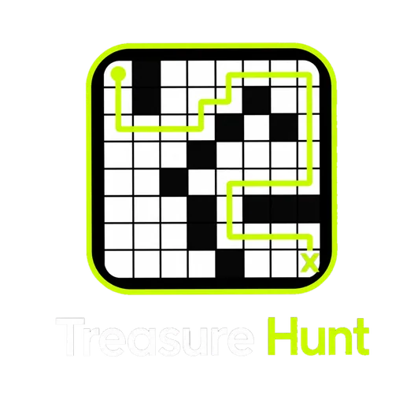

<!--
File: README.md
Document Title: Treasure Hunt Game
Author: Alysha Pursley
Date: August 2026
-->

<div align="center">



<h1>Treasure Hunt Game 🏴‍☠️</h1>

<p><a href="https://github.com/apursley2012/treasure-hunt-game/stargazers"></a> <a href="https://github.com/apursley2012/treasure-hunt-game/forks"></a> <a href="https://github.com/apursley2012/treasure-hunt-game/issues"></a> <a href="https://github.com/apursley2012/treasure-hunt-game/commits"></a> <a href="https://github.com/apursley2012/treasure-hunt-game"></a> <a href="https://github.com/apursley2012/treasure-hunt-game"></a></p>

<p><a href="https://apursley2012.github.io/treasure-hunt-game/"></a>      </p>

<p><strong>A playable treasure-hunt maze where a player races an intelligent JavaScript agent across randomized valid boards, with difficulty controls and the original reinforcement-learning source preserved for reference.</strong></p>

<p><a href="https://apursley2012.github.io/treasure-hunt-game/">Open the live project</a> · <a href="https://github.com/apursley2012/treasure-hunt-game">View the repository</a> · <a href="https://github.com/apursley2012/treasure-hunt-game/issues/new/choose">Report an issue or request an addition</a></p>

</div>

---

## Table of Contents 📖

*   [Project Overview 🔎](#project-overview)
    *   [Purpose 🎯](#purpose)
    *   [Design Style and Inspiration 🎨](#design-style-and-inspiration)
    *   [Main Color Palette 🌈](#main-color-palette)
    *   [Preview Screenshots 🖼️](#preview-screenshots)
*   [Key Features ✨](#key-features)
*   [Tech Stack 🛠️](#tech-stack)
*   [Live Demo 🚀](#live-demo)
*   [Installation 📦](#installation)
    *   [Local Use 💻](#local-use)
    *   [GitHub Pages Deployment 🌐](#github-pages-deployment)
*   [Usage 🧭](#usage)
*   [Project Structure 🗂️](#project-structure)
    *   [Pages Included 📄](#pages-included)
    *   [Core Files and Architecture 🧩](#core-files-and-architecture)
    *   [File and Folder Structure 🌳](#file-and-folder-structure)
*   [Maze and Agent Behavior 🧠](#maze-and-agent-behavior)
*   [Customization Guide 🎨](#customization-guide)
*   [Accessibility and Browser Compatibility ♿](#accessibility-and-browser-compatibility)
*   [Repository Relationship 🔗](#repository-relationship)
*   [Project Scope and Limitations 📌](#project-scope-and-limitations)
*   [Possible Future Enhancements 💡](#possible-future-enhancements)
*   [Contributing 🤝](#contributing)
    *   [Reporting Issues 🐛](#reporting-issues)
    *   [Requesting Additions 📝](#requesting-additions)
*   [License 📜](#license)
*   [Important Links 🔗](#important-links)
*   [Attribution ℹ️](#attribution)

---

<a id="project-overview"></a>

<details open>
<summary><h2><strong>Project Overview 🔎</strong></h2></summary>


**Treasure Hunt Game** is an interactive maze experience that lets a player and an automated agent work toward the same treasure on a generated board. The playable interface turns agent behavior into something visible: a person can make movement decisions directly while watching how the automated strategy approaches the same goal.

I designed the project so the maze is more than a decorative shell around an algorithm. Boards preserve a valid route, game state is clearly presented, and the agent race provides an immediate comparison between human navigation and programmed decision-making. That makes the underlying control problem easier to understand because the consequences of each decision are visible on screen.

The original Python, notebook, and reinforcement-learning material remains connected to the project where it helps explain the technical work behind the agent. The browser-facing game provides the interactive presentation, while the supporting source documents the experimentation and learning logic that informed it.

</details>

<a id="purpose"></a>

<details open>
<summary><h3><strong>Purpose 🎯</strong></h3></summary>


I created **Treasure Hunt Game** to turn an intelligent-agent maze problem into something people can actually play, watch, and compare. Each randomized board preserves a valid path to the treasure, the player can navigate the maze directly, and an automated agent races toward the same goal, which makes the difference between human choices and agent behavior visible instead of leaving it buried in code or notebook output. The original Python and reinforcement-learning material remains connected to the project so the playable experience and the underlying learning work can be explored together.
</details>

<a id="design-style-and-inspiration"></a>

<details open>
<summary><h3><strong>Design Style and Inspiration 🎨</strong></h3></summary>


Treasure Hunt Game uses a control-room and game-lab visual language to frame the maze, agent behavior, and learning results as something visitors can actively inspect. Dark backgrounds and deep-green panels keep the main content readable, while bright lime accents highlight controls, navigation, and game states. The game board, controls, and reinforcement-learning information remain the visual focus.

</details>

<a id="main-color-palette"></a>

<details open>
<summary><h3><strong>Main Color Palette 🌈</strong></h3></summary>


I pulled the palette below directly from the current project stylesheet `assets/css/core/tokens.css`.

The table lists the core theme tokens and their intended uses.

| Hex | Color Name | Complete Use in the Interface |
| --- | --- | --- |
| `#050505` | Background | Main page background; blocked maze cells |
| `#0B0F0F` | Background 2 | Secondary dark background |
| `#101414` | Panel | Primary dark panels |
| `#151A1A` | Panel 2 | Secondary dark panels |
| `#F8F8F8` | Open Cell | Traversable maze cells |
| `#111111` | Grid Line | Maze grid boundaries |
| `#A7FF00` | Lime | Navigation, actions, status, and highlights |
| `#FFFFFF` | White | High-contrast text |
| `#A8B3B3` | Muted | Secondary text |
| `#E03131` | Red | Warning and error accents |

</details>

<a id="preview-screenshots"></a>

<details open>
<summary><h3><strong>Preview Screenshots 🖼️</strong></h3></summary>


Preview images can be added to the repository when screenshots are available.


#### 🖼️ Screenshot Gallery


No screenshot gallery files are currently included in the repository.

</details>

---

<a id="key-features"></a>

<details open>
<summary><h2><strong>Key Features ✨</strong></h2></summary>


*   **Generate randomized 8×8 mazes that retain a valid path to the treasure**
*   **Move the player through valid cells while blocking illegal moves**
*   **Run an automated JavaScript agent toward the same treasure**
*   **Choose difficulty settings that change the race behavior**
*   **Track movement, reward-style feedback, and game status**
*   **Restart with a new valid maze**
*   **Preserve original Python/Jupyter/Keras source under `Original/`**
*   **Include project information, a case study, four articles, and a reflection page**

</details>

---

<a id="tech-stack"></a>

<details open>
<summary><h2><strong>Tech Stack 🛠️</strong></h2></summary>


*   **HTML**
*   **CSS**
*   **JavaScript**
*   **Python source**
*   **NumPy source**
*   **Keras/TensorFlow-era reinforcement-learning source**
*   **Jupyter Notebook source**

</details>

---

<a id="live-demo"></a>

<details open>
<summary><h2><strong>Live Demo 🚀</strong></h2></summary>


Open the published project here:

[https://apursley2012.github.io/treasure-hunt-game/](https://apursley2012.github.io/treasure-hunt-game/)

</details>

---

<a id="installation"></a>

<details open>
<summary><h2><strong>Installation 📦</strong></h2></summary>


</details>

<a id="local-use"></a>

<details open>
<summary><h3><strong>Local Use 💻</strong></h3></summary>


1. Clone or download the repository.
2. Keep the existing folder structure intact so the page can still find its styles, scripts, data, and assets.
3. From the repository root, run `python3 -m http.server 8000` and open `http://localhost:8000/` so browser JavaScript modules load over HTTP.
4. Before I publish changes, I check the game controls, navigation, and responsive layout.

</details>

<a id="github-pages-deployment"></a>

<details open>
<summary><h3><strong>GitHub Pages Deployment 🌐</strong></h3></summary>


Keep `index.html` at the repository root, use relative asset paths, then enable **Settings → Pages → Deploy from a branch → main → / (root)**. GitHub Pages hosts the static HTML, CSS, and JavaScript; it does not execute the original Python/Jupyter learning code.

</details>

---

<a id="usage"></a>

<details open>
<summary><h2><strong>Usage 🧭</strong></h2></summary>


Open the game at `pages/index.html`, generate a maze, choose a difficulty, and race the JavaScript opponent to the treasure using keyboard or on-screen controls. The case study, four articles, reflection, and original Python/Jupyter files provide deeper implementation context. The site does not use accounts or a backend database.

</details>

---

<a id="project-structure"></a>

<details open>
<summary><h2><strong>Project Structure 🗂️</strong></h2></summary>


</details>

<a id="pages-included"></a>

<details open>
<summary><h3><strong>Pages Included 📄</strong></h3></summary>


| Page / Area | Purpose |
| --- | --- |
| `index.html` | Redirects to the playable browser game |
| `pages/index.html` | Playable browser game |
| `pages/info.html` | Project overview and implementation context |
| `pages/case-study.html` | Detailed project case study |
| `pages/articles.html` | Four-article writing index |
| `pages/article.html` | Deep Q-learning article |
| `pages/article-browser.html` | Browser engineering article |
| `pages/article-neural-networks.html` | Neural networks and responsible AI article |
| `pages/article-privacy-ai.html` | Privacy and personalization article |
| `pages/reflection.html` | Project reflection |
| `pages/privacy.html`, `pages/terms.html`, `pages/accessibility.html` | Site policies and accessibility |
| `Original/` | Original Python/Jupyter learning source |

</details>

<a id="core-files-and-architecture"></a>

<details open>
<summary><h3><strong>Core Files and Architecture 🧩</strong></h3></summary>


The repository keeps the static browser game in `pages/` and `assets/`, with JavaScript maze rules in `assets/js/treasure-maze.js`, opponent behavior in `assets/js/competitive-agent.js`, and game orchestration in `assets/js/app.js`. The independent Python/Jupyter deep Q-learning experiment is preserved in `Original/` and is not executed by the browser game.

</details>

<a id="file-and-folder-structure"></a>

<details open>
<summary><h3><strong>File and Folder Structure 🌳</strong></h3></summary>


```text
treasure-hunt-game/
├── README.md
├── LICENSE
├── THIRD_PARTY_NOTICES.md
├── index.html
├── 404.html
├── pages/
│   ├── index.html
│   ├── info.html
│   ├── case-study.html
│   ├── articles.html
│   ├── article.html
│   ├── article-browser.html
│   ├── article-neural-networks.html
│   ├── article-privacy-ai.html
│   ├── reflection.html
│   ├── privacy.html
│   ├── terms.html
│   └── accessibility.html
├── assets/
│   ├── css/
│   ├── js/
│   └── images/
└── Original/
    ├── treasure_hunt_game.ipynb
    ├── treasure_maze.py
    ├── game_experience.py
    ├── requirements.txt
    └── README.md
```

This tree highlights the major files and directories verified in the current project.

</details>

---

<a id="maze-and-agent-behavior"></a>

<details open>
<summary><h2><strong>Maze and Agent Behavior 🧠</strong></h2></summary>


The browser game separates valid-maze generation from agent movement. A randomized board is only accepted when the start and treasure remain connected, so the difficulty comes from navigation rather than accidentally generating an unwinnable board.

The JavaScript agent is intentionally described as an intelligent game agent, not as live deep-Q training. The original reinforcement-learning implementation belongs to the preserved Python/Jupyter source. The published GitHub Pages experience reproduces the problem and race behavior in a browser-safe way.

</details>

---

<a id="customization-guide"></a>

<details open>
<summary><h2><strong>Customization Guide 🎨</strong></h2></summary>


The safest way to customize or extend **Treasure Hunt Game** is to preserve its existing workflow first, then change one layer at a time. Update project content and data in the files that already own that information, keep visual changes inside the existing style system, and test every page that shares the changed component or data source. New features should solve a problem that belongs to this project instead of copying a feature from an unrelated application.

For visual changes, update the documented palette intentionally and re-check contrast, responsive spacing, screenshots, and any state colors that depend on the same variables. For data or logic changes, test both the normal path and empty/error/edge cases before publishing.

</details>

---

<a id="accessibility-and-browser-compatibility"></a>

<details open>
<summary><h2><strong>Accessibility and Browser Compatibility ♿</strong></h2></summary>


The public interface should remain keyboard-navigable, readable at common mobile and desktop widths, and usable without relying on color alone to communicate state. Form controls should keep visible labels or accessible names, images should use meaningful `alt` text, focus indicators should remain visible, and decorative animation should respect reduced-motion preferences when motion is present. Browser compatibility should be checked in current Safari, Chrome, Firefox, and Edge where practical.

</details>

---

<a id="repository-relationship"></a>

<details open>
<summary><h2><strong>Repository Relationship 🔗</strong></h2></summary>


**Treasure Hunt Game** is documented as its own project. Supporting case studies, articles, source history, static presentation layers, or backend/runtime folders are parts of this repository only when they help explain or run this project. They should not be described as separate replacement projects.

Where this repository contains both a static GitHub Pages layer and source that requires another runtime, the two are related but not interchangeable: the static layer provides the public experience that can run in a browser, while the source/runtime layer preserves functionality that GitHub Pages cannot execute directly.

</details>

---

<a id="project-scope-and-limitations"></a>

<details open>
<summary><h2><strong>Project Scope and Limitations 📌</strong></h2></summary>


The published GitHub Pages site is a static browser game using JavaScript maze generation and pathfinding; it does not execute Python training, serve a trained neural network, authenticate users, or store accounts in a database. The original Python/Jupyter deep Q-learning notebook remains separate, and a complete training run on a current TensorFlow/Keras environment has not been verified.

</details>

---

<a id="possible-future-enhancements"></a>

<details open>
<summary><h2><strong>Possible Future Enhancements 💡</strong></h2></summary>


*   Add optional visualization of the agent’s chosen path
*   Expose more difficulty parameters without making the controls cluttered
*   Add seedable maze generation for reproducible comparisons
*   Add automated tests that verify every generated maze remains solvable

</details>

---

<a id="contributing"></a>

<details open>
<summary><h2><strong>Contributing 🤝</strong></h2></summary>


Contributions, bug reports, and practical improvement suggestions are welcome when they preserve the existing project direction and do not replace its identity with a generic redesign.

</details>

<a id="reporting-issues"></a>

<details open>
<summary><h3><strong>Reporting Issues 🐛</strong></h3></summary>


When reporting a problem, include the page or workflow involved, what you expected, what actually happened, browser/device information when relevant, and a screenshot if the issue is visual.

</details>

<a id="requesting-additions"></a>

<details open>
<summary><h3><strong>Requesting Additions 📝</strong></h3></summary>


Feature requests should explain the user problem the addition would solve and how it fits the existing project. Project-specific improvements are preferred over adding features only because they are common in other applications.

</details>

---

<a id="license"></a>

<details open>
<summary><h2><strong>License 📜</strong></h2></summary>


The repository includes a proprietary `LICENSE` governing material I own; it is not an open-source license. See `THIRD_PARTY_NOTICES.md` for separately licensed dependencies and fonts. Public visibility does not grant permission for unrestricted reuse.

</details>

---

<a id="important-links"></a>

<details open>
<summary><h2><strong>Important Links 🔗</strong></h2></summary>


*   **Live Project:** [https://apursley2012.github.io/treasure-hunt-game/](https://apursley2012.github.io/treasure-hunt-game/)
*   **Repository:** [https://github.com/apursley2012/treasure-hunt-game](https://github.com/apursley2012/treasure-hunt-game)
*   **Issues / Requests:** [https://github.com/apursley2012/treasure-hunt-game/issues/new/choose](https://github.com/apursley2012/treasure-hunt-game/issues/new/choose)

</details>

---

<a id="attribution"></a>

<details open>
<summary><h2><strong>Attribution ℹ️</strong></h2></summary>


`THIRD_PARTY_NOTICES.md` identifies third-party dependencies and fonts. The origin and rights of any historical educational starter material in `Original/` have not been independently established.

</details>

---

<div align=center>
   
***Made with ❤️ and a bit of 🪄.***
<br>
**©️ 2026 Alysha Pursley. All Rights Reserved.**

</div>


